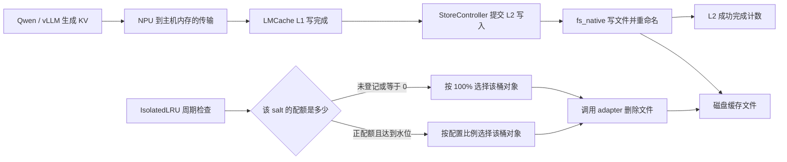

# L2 恒 0：现场实验复核、IsolatedLRU 用法与 NPU 适配边界

日期：2026-10-15。

## 1. 先给结论

**结论：你提供的 A3 实验已足以支持“写入成功后被零配额驱逐”，下一步优先补正配额对照；目前没有证据要求为 IsolatedLRU 修改 NPU 内存层。**

依据是两组实验的组合：同一套 NPU 环境，保留 IsolatedLRU 时报告成功保存 12 个 chunk、随后驱逐 12 个、用量归零；去掉该配置后保留 12 个文件。公开 MP 源码也明确规定：未登记配额的 `cache_salt` 配额为 0，清理比例强制为 1.0。这条判断没有 GPU/NPU 分支。[S1][S2]

可以给出的结论分三层：

| 问题 | 当前结论 | 证据边界 |
|---|---|---|
| A3 复刻为什么 L2 归零？ | 高置信支持 IsolatedLRU 零配额清理 | 现场文本实验报告与公开源码一致；本机未接触原始运行环境 |
| 原始 910B 服务是否完全同根因？ | **未最终核实**，是当前最强候选 | 原始镜像提交、实际 salt、quota 状态及对应清理日志未提供；复刻还改了 transfer mode |
| 保留 IsolatedLRU 能否在 NPU 正常使用？ | 源码支持，需补一组正配额验收 | 目前报告只有“无配额”和“去掉策略”，尚未报告“有正配额并保留策略” |
| GPU 能用而 NPU 不能，是否证明 NPU 底层有问题？ | 不能这样推出；差异原因**未核实** | 配额状态、代码版本、实际传输路径和驱逐线程运行状态也会造成差异 |

这里按你说的“这个参数”指 L2 JSON 内的 `eviction: {eviction_policy: IsolatedLRU, ...}` 分析。`use_odirect` 是另一维开关，后文单独处理。

## 2. 用白话理解：写入通路和清理通路是两件事

**结论：这次主要是“清理规则把文件删了”，不是“搬运数据的 NPU 通路没有写进去”。**

| 词 | 在这个问题里的意思 |
|---|---|
| L1 | LMCache 放在主机内存里的 KV 缓存 |
| L2 | 本例中由 `fs_native` 管理的磁盘缓存文件 |
| KV / chunk | 模型计算中间结果，以及按固定 token 数切出的缓存块 |
| 驱逐 / eviction | 按规则删除缓存对象，腾出空间 |
| LRU | 优先清理较久没用的对象 |
| IsolatedLRU | 按 `cache_salt` 分桶，各桶独立维护 LRU；超配额时只清自己的桶 |
| cache_salt | 请求携带的缓存分组标识；不同值拥有不同缓存身份，未传时通常为空字符串 |
| quota | 给某个桶登记的容量预算。本 MP 路径中，未登记表示 0，不表示不限量 |
| O_DIRECT / DIO | 文件读写绕过操作系统页缓存的一种方式；可能对内存地址和长度有额外要求 |



上图最后一条线表示操作同一批磁盘文件。NPU 内存是否适合文件系统读写，影响前半段；配额是否为 0，控制后半段。即使前半段完全正常，后半段仍能把目录清空。

当前公开逻辑等价于：

```python
# 逻辑摘录，不是建议补丁。
limit = quota_manager.get_limit_bytes(cache_salt)  # 未登记 -> 0
if user_bytes < trigger_watermark * limit:
    continue
effective_ratio = 1.0 if limit == 0 else eviction_ratio
```

所以把 `eviction_ratio` 从 0.1 改成更小，或者把水位从 0.8 改成别的正数，都解决不了零配额：`watermark × 0` 仍然是 0，清理比例仍被覆盖成 1.0。[S1][S2]

## 3. 这份实验报告需要订正的地方

**结论：主要定位方向成立，但下面几句不能直接作为最终技术结论。**

| 原说法 | 建议定稿 | 依据 |
|---|---|---|
| 没传 `--l1-use-lazy`，所以未开 lazy | 未传该参数不能证明关闭。公开核对版本默认 `True`；旧现场默认值和实际 allocator **未核实** | 公开参数采用 `BooleanOptionalAction, default=True`；显式关闭的写法是 `--no-l1-use-lazy`，仍以运行时为准。[S3] |
| 本次与 #305 无关，因为没开 lazy | 本次以 buffered 写成功、随后被驱逐为主要证据，应按独立配额问题处理；不依赖 lazy 是否关闭来论证 | 本次 `use_odirect=false`；此前 #305 解决原 O_DIRECT 故障是你已报告的现场结果 |
| O_DIRECT 务必不能和 lazy 一起用 | 对仍保留旧 Ascend allocator 替换且会复现故障的组合，需要规避或应用 #305；不能普遍禁止修复后的 lazy + O_DIRECT | #305 删除 allocator 替换，保留 lazy 功能；你已验证原故障可由该修改解决。[S4] |
| store completed 计数已有，但文件还要等异步刷出来 | 请求提交是异步的；公开 fs_native 成功完成发生在写入、关闭、重命名之后。若完成后目录为空，应查后续删除、查询对象/挂载路径或 fork 差异 | `connector.cpp` 的写入和 rename 先返回，worker 随后发 completion，StoreController 再报告完成。[S5][S6][S7] |
| completed requests=4 就证明 4 次写成功 | 该请求计数表示任务终结，失败也可增加；本例更有力的是成功对象计数 12、去掉策略后的实际文件，以及相应删除证据 | 成功/失败都会发布完成事件；成功分支才携带成功对象的 salt 计数。[S7][S8] |
| completed 等于断电安全落盘 | 本问题只能说明后端完成及文件可见，不能推出掉电持久化 | 公开该写入路径未调用 `fsync`/目录同步；这与“文件是否可见”不同。[S5] |
| 换 `auto` 后和现场完全一致 | 这是配额机制复刻，保留传输路径限定；`auto` 的实际模式仍需读日志确认 | server 的 `auto` 允许两种模式；客户端还会选择实际模式。[S9] |
| 换成 LRU 就能长期使用 | 如需全局容量清理，需同时配置合适的 `max_capacity_gb` | 默认容量为 0 时，普通 LRU 的全局容量驱逐不会启用。[S10] |

`evicted_objects` 也应与实际目录变化一起看：公开控制器在调用删除后按所选对象发布驱逐事件，不逐个证明文件系统删除成功。因此“成功对象 12 + 驱逐动作 12 + 目录归零 + 去掉策略后保留文件”的组合，比单看一个 counter 更有说服力。文件观察还需对应同一时刻、实例和挂载位置；异步监控采样或其他文件系统客户端的元数据可见性，不等于 native 写入在成功 completion 之后才执行。[S2][S5][S8]

“A3/910A”这样的机型表述也建议以实际 `npu-smi` 输出定稿；本文不据容器名推断芯片型号，确切型号**未核实**。

报告数值可以统一写为：

`12 × 150,994,944 = 1,811,939,328 bytes = 1.6875 GiB ≈ 1.812 GB`。

`16216` 个输入 token 按 `4096` 切完整块，得到每 rank 3 块；4 个 TP rank 对应 12 个对象，与报告吻合。但计数吻合本身不替代 KV 内容正确性验证。

## 4. 下一步只优先补这一组：正配额 + 原 IsolatedLRU

**结论：你已有的两组实验无需全部重跑；最有价值的新实验是保留策略，给实际 salt 登记正配额。**

目标：证明“同样 NPU 写入链路，只补配额，文件即可保留”。

固定已成功的环境、模型、请求长度、`use_odirect=false`、当前可用 transfer mode 和 IsolatedLRU 配置。使用自有测试实例和新目录。不要再执行报告中的广泛 `pkill -9 -f`；只管理本次启动并记录的 PID，避免误停其他服务或再次污染设备状态。

### 固定步骤

1. 确认测试 HTTP 端口和 `/status` 中的 L2 `base_path` 属于自己的实例。下面以 `18080` 为例；不能直接拿它修改端口上已有的未知服务。
2. 从此前超配额日志中的 `cache_salt=%r`，或实际请求/IPC key，确定请求的 salt。没有显式 salt 时，公开版本映射为空字符串，但旧现场仍以实际值为准。
3. 启动后先不给业务流量，为该 salt 注册 8 GiB 配额，再 GET 确认。
4. 给 Qwen 发一条**更换开头前缀**的长请求，避免全部命中已有 L1，导致没有新保存任务。
5. 比较请求前后的指标增量、文件数和总字节数；跨多个 eviction 周期观察，测试可观察约 10 秒。不要只采一个瞬时值。
6. 通过后才恢复接业务；每次 LMCache server 重启都执行配额确认/重放。

确认实际 salt 为 `""` 后，在测试机 Bash 中执行：

```bash
# 前提：已确认这个端口属于自己的测试实例。
LM_HTTP='http://127.0.0.1:18080'

curl --fail --silent --show-error "$LM_HTTP/healthcheck"

curl --fail --silent --show-error \
  -X PUT "$LM_HTTP/quota/_default" \
  -H 'Content-Type: application/json' \
  -d '{"limit_gb":8}'

curl --fail --silent --show-error "$LM_HTTP/quota/_default"
```

预期 GET 中有 `exists: true`、`limit_gb: 8.0`。字段虽然叫 `gb`，该实现实际按 `1024**3` 换算，即 GiB。[S11]

若实际 salt 是 `tenant_a`，改用 `/quota/tenant_a`。**`_default` 只是 HTTP 表示空字符串的特殊名称，不是给所有 salt 的默认配额，也不是通配符。** 不要把业务 salt 真的设成 `_default`。`GET /quota` 只列已登记项，不能用列表里没有某个 salt 来证明没有该 salt 的请求。[S11]

若 HTTP 返回 404，先核对本地版本是否提供该 API；返回 401/403 则按现有部署的认证方式调用。这些不表示 NPU 写盘失败。

### 判定表

| 观察结果 | 结论与下一步 |
|---|---|
| 成功对象增加；约 1.6875 GiB 文件跨周期保留；无新增清理 | 正配额修复成立。该数据低于 `8 × 0.8 = 6.4 GiB`；无需为本现象新增 NPU 底层补丁 |
| GET 配额正确，但清理日志仍 `limit=0` | 核对日志的 salt、PUT 的目标实例和实际使用的 QuotaManager；不能先改内存分配 |
| 给 `tenant_a` 配了额，实际 key/log 是 `cache_salt=''` | 可能是 connector/版本丢字段，或请求本来没携带该值；沿请求→metadata→adapter→IPC key 定位，**具体位置未核实** |
| 已匹配正配额，但用量确实超过 `0.8 × quota`，日志 ratio=0.10 | 正常阈值驱逐；增加预算或接受清理，不应把它当 NPU 失败 |
| 没有新提交，或者没有完整 chunk | 查 L1 命中、请求 token 数与写完成通知；不是 quota 对照的有效样本 |
| 已提交但有 store failed，成功对象不增长 | 转入传输/文件写入故障；此时才需要下面的 NPU 底层分流 |
| 成功对象增加、未驱逐却目录仍空 | 检查查盘实例/挂载命名空间、实际 base_path、其他清理者及 native/Python 版本；必要时只跟踪自己服务的 rename/unlink |

**结论：为了恢复保留文件功能，上面的正配额对照是优先项；若还要验收“达到水位能正确清理”，再补一个小配额实验。**

在同一个自有测试实例中，停止新增请求后，把空 salt 配额从 8 改为 1 GiB。约 1.6875 GiB 的现有数据会高于 0.8 GiB，预期日志 `limit=1073741824`、`ratio=0.10`，用量逐周期降低，最后保留一部分对象。清理按**对象数量比例**取整，非精确 10% 字节，不能要求每次字节下降恰好相等。完成后恢复 8 GiB 并 GET 确认。[S2][S12]

不必再专门删除配额验证全清：你已有零配额对照。尤其不要在业务实例调用 DELETE 来“取消限制”——它会恢复成零预算语义。

## 5. GPU 能用，应该怎样设计有针对性的 NPU 对照？

**结论：先对比影响清理规则的运行状态，再把剩余故障下沉到 NPU；不要从“GPU 正常”直接跳到“ACL 内存有错”。**

同样启动字符串并不保证相同运行状态。下面只需让 GPU 侧回传文字，不要求传原始文件，也不必重跑整个模型实验矩阵：

| 两边比较项 | 为什么有区分力 |
|---|---|
| 实际导入的 LMCache、Ascend、vLLM 文件路径和 commit；native `.so` 路径 | 旧版本、容器内额外副本或不同 native 扩展，可能运行不同逻辑 |
| 是 MP `fs_native` 还是进程内磁盘后端；是本地 MP eviction 还是 coordinator 管理 | 名称相似不代表走相同 quota 判定；不能混用另一条路径的“未配置不限额”语义 |
| L2 内 IsolatedLRU 是否真正生效，controller 是否健康 | 只解析配置成功不代表后台清理循环运行 |
| 实际 cache_salt、该 salt 的 GET quota 结果 | GPU 可能已有外部初始化，而 NPU 没有；这是待核假设，不是已知事实 |
| 正用量时是否出现 `over quota`、实际 limit 和 ratio | 直接说明是否进入了同一个决策分支 |
| 客户端日志的实际 transfer mode | `auto` 并不是一个固定的数据搬运实现 |

若两侧确实执行相同 MP 源码、实际 salt 都未登记、已有正用量且驱逐循环正常运行，那么两侧都会进入 `limit=0 → ratio=1.0`。GPU 不清理时，以上至少有一个前提需要重新核实。

### 真正靠近 NPU 底层的分流

**结论：NPU 底层验证应由具体失败信号触发。当前 12 个成功对象随后被删除，不能靠改分配器来阻止。**

| 失败信号 | 优先查看的 NPU 环节 | 最小验证与改动边界 |
|---|---|---|
| `lmcache_driven` 注册、连接或拷贝未完成；无 L1 写完成/无 L2 提交 | NPU IPC memory/event、线程 ACL context、stream 同步、transfer mode 接口兼容 | 保持配额已正确设置，只比较实际两种传输模式；留首个异常和注册/拷贝/完成通知的位置。修复实际失配接口，归属 Ascend adapter 或主仓设备实现取决于加载路径 |
| buffered 正常，O_DIRECT store failed，底层 `EFAULT/Bad address` | L1 的实际主机内存来源，以及内核直接 I/O 对该内存的访问能力 | 在 #305 已生效的进程核对真实 allocator；若仍失败，再用相同数据、长度、偏移、文件系统，对比原 L1 缓冲与普通、正确对齐的 CPU 缓冲 |
| O_DIRECT `EINVAL` / 地址对齐错误 | 指针、传输长度、文件偏移和文件系统要求 | 检查三者约束以及 native 实际是否启用 O_DIRECT；不要把 `EINVAL` 自动归成 ACL 内存问题 |
| 写入完成但读回校验不一致 | NPU→主机拷贝完成时机、异步任务期间内存是否被复用、读回→NPU 的同步 | 比较内容校验和生命周期；只有出现该证据才调查数据正确性，不重复本轮配额实验去猜 UAF |
| 已成功写入，随后 `limit=0, ratio=1.0` 删除 | 配额、salt 透传、控制面初始化 | 修配额或丢字段处；不进入 ACL 分配器改造 |

GPU 与 NPU 确有底层差异：主机内存分配器、设备注册、IPC/event、异步拷贝实现不同。此前 #305 解决的就是主机内存路线差异：恢复主仓普通 CPU 分配后再注册到 NPU 的 lazy 路线，避开旧 Ascend lazy 替换路径。它解决“能否写”的问题；IsolatedLRU 配额控制“写完保不保留”。[S4][S13]

即使某次复制到新缓冲后恢复正常，也不能只凭这一点就认定唯一根因：复制同时可能改变分配来源、对齐、生命周期和时序。普通 `bytes()` 没有保证 O_DIRECT 所需地址对齐，不应据此直接落最终补丁。

当前已有 #305 修复验证，无需为了这次 quota 现象重做全部内存实验。只有你确实计划继续用 `use_odirect=true`，才在**配额已经正确的条件下**只切换这个开关验收，避免把成功写入后删除再次当作写失败。

## 6. 如果长期保留 IsolatedLRU，我们实际要适配什么？

**结论：先适配启动编排；只有现有接口不足或真实字段丢失，才改框架代码。**

### 方案 A：现有 API 足够，先不改 LMCache 源码

启动顺序固定为：

```text
启动自己的 LMCache server
    ↓
确认 HTTP 健康、正确 L2 目录和 controller 状态
    ↓
为实际 salt PUT 正配额，GET 核对成功
    ↓
启动/放行业务请求
    ↓
每次 LMCache server 重启，重新确认和下发配额
```

公开本地 MP 路径创建新的 `QuotaManager()`，初始登记表为空；已核启动路径未从静态配置恢复这张表。HTTP 健康不等于业务配额已经就绪。已有外部控制器是否自动重放，现场**未核实**。[S14]

这部分可以放在你们自己的部署脚本，不需要 NPU plugin 改变租户策略。若 vLLM 已运行，先保证请求入口暂不放流量，配额确认后恢复。

预算需按盘空间安排：这里的 8 GiB 是针对 1.6875 GiB 数据的测试值，不能直接当生产容量建议。多租户配额总和、多个实例共享磁盘和瞬间写入都要留余量。配额是周期清理阈值，不是阻止写入的硬上限。

**特别注意：该版本 IsolatedLRU 走逐 salt 分支；即使另配 `max_capacity_gb`，也不额外执行普通全局容量驱逐。** 单个 L2 与多 L2 的含义也不同：quota HTTP 用量合计所有 L2，而驱逐逐适配器比较。不要把它理解成覆盖整个磁盘的全局硬配额。[S2][S15]

### 方案 B：只有确定存在启动初始化需求，再补主仓配置

**结论：如果必须保证驱逐器启动前已有配额，合理的框架改动是“显式初始配额”，而不是给 NPU 特判放行。**

最小改动责任边界：

1. 在主仓 MP 配置和参数解析中增加显式初始配额输入；具体字段名待实现时按目标版本约定确定，本文没有声称现有 CLI 已支持。
2. 在 `StorageManager` 创建 `QuotaManager` 后、启动 L2 eviction controller 前装入配额，复用现有 quota 校验逻辑，不能创建第二套不一致的配额表。
3. 保留现有运行时 PUT/GET/DELETE 语义，更新文档说明重启恢复行为。
4. 针对改动验证：初始正配额能在首次清理前生效、未知 salt 仍按既有规则处理、PUT 可更新、无效值报错。无需为此重建 NPU 测试框架。

这是需要时的补丁方向，**本轮未实现、未测试**。已有磁盘文件在重启时是否被自动纳管、是否会遭遇恢复配额前的清理窗口，仍须按目标版本核实，不能声称本次已复现该窗口。

### 方案 C：只有确认 salt 在 Ascend 链路丢失，才补透传

**结论：若请求身份在兼容层丢失，应修那个具体位置，不能把所有 NPU 请求重写成同一个 salt。**

核对：`request.cache_salt → request metadata → adapter 的 cache_salts → IPCCacheServerKey.cache_salt → ObjectKey.cache_salt`。只补漏掉的字段或参数，并验证 scheduler lookup、worker store/retrieve 使用一致的 salt。旧协议缺字段可能回退成空 salt；具体现场是否如此**未核实**。[S16]

不要直接把 `get_limit_bytes()` 未知值从 0 改成无限：这是改变公开的允许名单语义。也不要在 Ascend plugin 为所有未知 salt 自动登记大额度，或合并租户身份；这些会影响隔离和容量控制。

### 如果只是单用户缓存，不需要按 salt 隔离

**结论：可以选择全局 LRU，但要带容量预算；这属于选择另一套策略，不是 NPU 修复。**

例如下面仅展示 JSON 配置形状，`64` 是示例，实际需按测试盘可用空间调整：

```json
{
  "type": "fs_native",
  "base_path": "/your/own/test/l2",
  "num_workers": 4,
  "use_odirect": false,
  "max_capacity_gb": 64,
  "eviction": {
    "eviction_policy": "LRU",
    "trigger_watermark": 0.8,
    "eviction_ratio": 0.1
  }
}
```

不要改顶层 `--eviction-policy LRU` 来替代 L2 JSON 中的设置：顶层是 L1 策略，属于不同层。去掉整个 `eviction` 能作定位对照，但长期使用需要明确谁负责缓存容量清理。[S10]

## 7. 可以交给另一侧 Agent 的最小回传

**结论：不需要原始文件，只需回传下面这些文字就能判断关键分支。**

```text
【版本/路径】
LMCache commit 与导入路径：
LMCache-Ascend commit 与导入路径：
vLLM/connector 版本与文件路径：
native FS .so 路径：
PR305 修改是否在实际服务中生效：
实际 transfer mode / allocator 类型：

【正配额对照】
测试实例 HTTP 地址 / L2 base_path：
实际 cache_salt（明确区分空字符串与带字符的字符串）：
PUT 后 GET 返回（保留 exists、limit_gb、current_usage_gb）：
请求 token 数 / 新前缀标识：
请求前后成功 completed_objects 增量：
请求前后 evicted_objects 增量：
完成后跨多个清理周期的 文件数 / 字节数 / L2 usage：
若有清理日志，原文包含 salt、bytes、limit、watermark、ratio：
若有失败，首个异常或底层 errno；没有则写无：

【GPU 差异，可直接查现有服务，不必重跑大实验】
GPU 是否同一 MP 路径与相同 eviction 源码：
GPU 实际 salt / GET quota 返回：
GPU 是否有外部配额初始化组件：
未获取的项目明确写“未核实”。
```

最终结论建议写成：

> 在本次报告的 A3 复刻环境、MP fs_native、use_odirect=false 且未登记请求 salt 配额的配置下，成功写入后被 IsolatedLRU 按零配额全量清理，是 L2 用量归零的最有力解释；保留该策略的下一步是注册实际 salt 的正配额并验证文件保留，原始 910B 镜像及 GPU 对照差异尚未最终核实。

## 8. 核对范围与公开依据

本轮读取了你贴出的实验全文，并核对下列公开源码；**没有在本机执行 A3/NPU 或现场 MP 服务实验，也没有修改主仓/Ascend 代码**。

源码采用固定主仓提交 `f42f3d94b10b7d0d576fde0feb2aaae8987c4d35`；2026-10-15 查询到 dev 为 `b61b5b4ee4c218f409966c28d864e3066a32758f`，两者比较未改变本文核心 quota/eviction 文件。现场“9-29 v0.1.0”不能替代完整提交号，和公开版本的逐行一致性**未核实**。

- [S1：未知 salt 配额为 0](https://github.com/LMCache/LMCache/blob/f42f3d94b10b7d0d576fde0feb2aaae8987c4d35/lmcache/v1/distributed/quota_manager.py#L86)。
- [S2：MP 按 salt 清理、零配额覆盖 ratio、与全局分支互斥](https://github.com/LMCache/LMCache/blob/f42f3d94b10b7d0d576fde0feb2aaae8987c4d35/lmcache/v1/distributed/storage_controllers/eviction_controller.py#L309)。
- [S3：lazy 参数默认 True](https://github.com/LMCache/LMCache/blob/f42f3d94b10b7d0d576fde0feb2aaae8987c4d35/lmcache/v1/distributed/config.py#L831)。
- [S4：Ascend PR #305](https://github.com/LMCache/LMCache-Ascend/pull/305)；本文沿用已审查候选 `dc779e5d9e0427fbaef69ff2245d97476811868d` 的修改范围，不以本页链接表示当前合并状态。
- [S5：FS 写入、关闭、rename 与失败清理](https://github.com/LMCache/LMCache/blob/f42f3d94b10b7d0d576fde0feb2aaae8987c4d35/csrc/storage_backends/fs/connector.cpp#L165)。
- [S6：native worker 执行操作后报告 completion](https://github.com/LMCache/LMCache/blob/f42f3d94b10b7d0d576fde0feb2aaae8987c4d35/csrc/storage_backends/connector_base.h#L563)。
- [S7：StoreController 的成功和失败完成事件](https://github.com/LMCache/LMCache/blob/f42f3d94b10b7d0d576fde0feb2aaae8987c4d35/lmcache/v1/distributed/storage_controllers/store_controller.py#L737)。
- [S8：completed 请求计数与成功对象计数](https://github.com/LMCache/LMCache/blob/f42f3d94b10b7d0d576fde0feb2aaae8987c4d35/lmcache/v1/mp_observability/subscribers/metrics/l2.py#L140)。
- [S9：auto 允许两种 server transfer module](https://github.com/LMCache/LMCache/blob/f42f3d94b10b7d0d576fde0feb2aaae8987c4d35/lmcache/v1/multiprocess/server.py#L232)，[客户端解析实际 mode](https://github.com/LMCache/LMCache/blob/f42f3d94b10b7d0d576fde0feb2aaae8987c4d35/lmcache/v1/multiprocess/transfer_context/worker_transfer.py#L1061)。
- [S10：L2 全局驱逐需要容量能力，普通策略不满足会跳过](https://github.com/LMCache/LMCache/blob/f42f3d94b10b7d0d576fde0feb2aaae8987c4d35/lmcache/v1/distributed/storage_manager.py#L1502)，[fs_native 配置与容量](https://github.com/LMCache/LMCache/blob/f42f3d94b10b7d0d576fde0feb2aaae8987c4d35/lmcache/v1/distributed/l2_adapters/fs_native_l2_adapter.py#L48)。
- [S11：quota HTTP 哨兵、GiB 换算和 GET/PUT/DELETE](https://github.com/LMCache/LMCache/blob/f42f3d94b10b7d0d576fde0feb2aaae8987c4d35/lmcache/v1/multiprocess/http_apis/quota_api.py#L24)。
- [S12：IsolatedLRU 按对象数量取清理比例](https://github.com/LMCache/LMCache/blob/f42f3d94b10b7d0d576fde0feb2aaae8987c4d35/lmcache/v1/distributed/eviction_policy/isolated_lru.py#L163)。
- [S13：主仓 NPU 内存注册实现](https://github.com/LMCache/LMCache/blob/f42f3d94b10b7d0d576fde0feb2aaae8987c4d35/lmcache/v1/platform/devices/npu/pin_memory.py#L223)。
- [S14：MP StorageManager 创建配额管理器和驱逐器](https://github.com/LMCache/LMCache/blob/f42f3d94b10b7d0d576fde0feb2aaae8987c4d35/lmcache/v1/distributed/storage_manager.py#L205)。
- [S15：quota 用量合计 L2 适配器](https://github.com/LMCache/LMCache/blob/f42f3d94b10b7d0d576fde0feb2aaae8987c4d35/lmcache/v1/distributed/storage_manager.py#L1012)。
- [S16：worker 透传 cache_salts](https://github.com/LMCache/LMCache/blob/f42f3d94b10b7d0d576fde0feb2aaae8987c4d35/lmcache/integration/vllm/lmcache_mp_connector.py#L996)，[adapter 写入 IPC key](https://github.com/LMCache/LMCache/blob/f42f3d94b10b7d0d576fde0feb2aaae8987c4d35/lmcache/integration/vllm/vllm_multi_process_adapter.py#L1873)。
