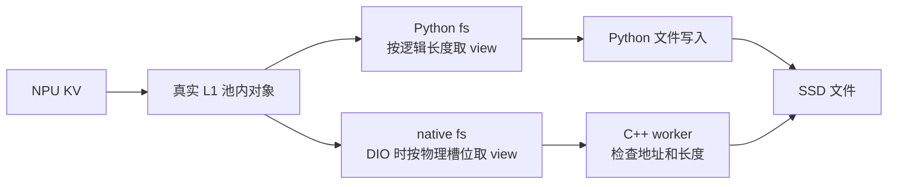

# fs_native 为什么值得单独复现，为什么不推翻 PR305

日期：2026-10-16。源码结论按固定公开版本；本侧 NPU 实验尚未运行。

## 1. fs_native 是很有价值的分界点

**结论：可能主要暴露在 fs_native 链路，但不能直接说“额外配置错了”。它改变了交给文件系统的缓冲长度，以及异步执行/错误返回方式。**

可以把整个过程理解为：NPU 上的 KV 被搬到一块 CPU 内存，L2 adapter 决定怎样把这块内存写入 SSD。



逻辑长度是“有多少有效 KV 数据”；物理长度是“为它实际预留多大的槽位”。例如数据 4000 字节，为方便对齐预留了 4096 字节，末尾 96 字节是 padding。`fs_native` 的 padded view 不复制数据，还是从原 L1 地址开始。[native view](https://github.com/LMCache/LMCache/blob/ddcbe3ed01b9cdab765271bd98de0b9d9e3c4ced/lmcache/v1/distributed/l2_adapters/native_connector_l2_adapter.py#L94)

| 同一对象：逻辑4000、物理4096、FS检查单位4096 | Python `fs` | `fs_native` + DIO |
|---|---|---|
| 提交长度 | 4000 | 标准 TensorMemoryObj 提交4096 |
| 是否能通过长度条件 | 不能，本版回退普通I/O | 能，继续检查地址 |
| 地址不齐时 | 这一例没有进入DIO | C++明确拒绝，尚未open/write |
| 解释 | 普通I/O成功可能遮住问题 | 暴露原缓冲不满足DIO要求 |

这是示例，不是机主实际 DS 对象的测量值。两种 adapter 若都收到满足长度条件的缓冲，都可能受到 DIO 内存约束；不能概括为“Python fs 天生安全、native 必然有问题”。[Python store](https://github.com/LMCache/LMCache/blob/ddcbe3ed01b9cdab765271bd98de0b9d9e3c4ced/lmcache/v1/distributed/l2_adapters/fs_l2_adapter.py#L600)

## 2. PR305 和这里的关系

**结论：已知证据没有推翻 #305；它修的是 Lazy 池的分配来源，本轮补的是该池到 native FS 的实际集成验证。**

#305 移除 Ascend 对主仓 Lazy 的旧覆盖，让它恢复主仓的普通 CPU allocation、基址对齐和 NPU 注册路线。它没有修改所有 native/SHM/NUMA/DAX 分配入口，也不包办所有 FS 错误。[PR305](https://github.com/LMCache/LMCache-Ascend/pull/305)

当前标准 Lazy 超额分配后切到对齐基址，池内槽位也按 A 取整。因此当 A=D=4096，标准对象应满足：

```text
B % D = 0                 池基址齐
o % D = 0                 对象偏移齐
p = B + o → p % D = 0     对象地址齐
q = p                     view没有额外偏移
P % D = 0                 padded提交长度齐
```

这意味着：**不能只用“DS 对象大小不同”解释当前标准 Lazy 地址突然不齐。** 要么实际路径/版本不同，要么额外切分/view 改了地址，要么根因不是地址。主仓的基址修复已有 [PR4367](https://github.com/LMCache/LMCache/pull/4367)；普通 `torch.empty` 默认分配本身并不等于4096对齐。[Lazy实现](https://github.com/LMCache/LMCache/blob/ddcbe3ed01b9cdab765271bd98de0b9d9e3c4ced/lmcache/v1/memory_allocators/lazy_memory_allocator.py#L142)

## 3. 为什么 GPU 能用，NPU 可能失败

**结论：可以存在 host 内存实现差异；具体哪个差异导致机主故障仍未核实，不能归结为 NPU 算力或模型名称。**

文件最终由 CPU/Linux 写入，GPU/NPU 路线仍可能选择不同的 CPU 内存分配、注册及映射方法。某种设备分配器提供的 host 地址恰好满足文件系统要求，另一种则未承诺；即使地址相同程度地对齐，页映射和生命周期也可能不同。

Ascend 当前普通 native host 分配入口使用 `aclrtMallocHost`；公开代码没有在该入口额外实现任意4096对齐。这只能说明需要核实际返回值，不能宣称 ACL 必然不齐。更不能拿该入口的实验替代 #305 所影响的主仓 Lazy。[Ascend native 分配](https://github.com/LMCache/LMCache-Ascend/blob/b813e970075983e94e86cc2911a40b1c00e7c780/csrc/mem_alloc.cpp#L12)

Qwen/DS 的名字主要影响实际 KV 布局、大小和可能的分支选择。只有建立“模型变化→实际对象/路径变化→错误输入”的联系，模型差异才有解释力。不能把权重量化格式当 KV dtype，不能猜 DS 的 MLA 维度。

## 4. 本版 native FS 实际检查什么

**结论：配置 DIO=true 不保证每次用了直接 I/O；须区分 guard、系统调用和完成通知。**

[本版 C++](https://github.com/LMCache/LMCache/blob/ddcbe3ed01b9cdab765271bd98de0b9d9e3c4ced/csrc/storage_backends/fs/connector.cpp#L49) 的主要顺序为：

```text
新key（已有文件会跳过真正写入）
    → D=0 或 length%D≠0：不启用 O_DIRECT
    → length%D=0 且 address%D≠0：抛地址错误
    → 两者都齐：以 O_DIRECT 打开文件并写入
    → worker completion 返回 ok/error
```

这里 D 来自文件系统 `statvfs.f_bsize`，是这版实现的检查单位，不等于所有 Linux 文件系统的完整 DIO 契约。实际直接 I/O 还涉及文件偏移、内核/文件系统支持；需要时再用系统调用 trace 或内核支持的 DIO alignment 查询核实。地址 guard 发生在 open/write 前，trace 没有失败 write 并不反驳该错误。

一个批次 `ok=false` 也不代表其中每个对象都没写成。wrapper 的 store completion 未充分输出已经收到的 error，宜先补诊断日志，不能只看 failed 计数决定重写分配器。

## 5. 复现怎样收敛到修改

**结论：先定位第一个违约的边界，只修该点；目前没有足够新证据再实施一个分配器补丁。**

| 本侧真实复现 | 优先修改位置 | 必须保护的行为 |
|---|---|---|
| 仍加载旧 Ascend Lazy 覆盖 | 落实 #305 等价删除、纠正加载路径 | 新进程实际使用主仓 Lazy |
| 主仓 Lazy 缺旧基址修复 | 回补现有基址对齐逻辑 | backing Tensor 所有权、注册/注销范围、释放 |
| A 不满足实际 D | 在现有启动配置设置有效 A，核新池和槽位 | 新目录，避免混用历史物理布局 |
| B齐、o不齐，或p齐、q不齐 | 具体槽位/group/view切分处 | 有效数据起点、范围、内容完整 |
| non-lazy ACL池真实B不齐 | Ascend该分配路径的分配/释放对 | 保存原始分配指针；不能round后再用错指针释放 |
| 地址长度齐，但write EFAULT | 实际分配映射、有效范围、异步持有者 | worker结束前对象不可释放/复用 |
| 文件成功写出后删除 | quota/eviction流程 | 不误改DIO或PR305 |
| 组件成功、MP失败 | MP传输/adapter生命周期及实际对象 | 先取得实际task/error后选补丁 |

如果最终必须引入对齐暂存区，需要明确分配者、完整物理范围、写入前的数据复制、异步完成后的释放和load方向内容回填；这是有开销的新方案，不作为当前默认。`bytes()` 既无 DIO 地址保证，也不能自动解决异步所有权；在现有 view 上直接向上挪地址会丢失 KV 开头或越界。

## 6. 目前可下的结论

**结论：`fs_native + O_DIRECT` 是当前最值得验证的集成边界；#305 保留，机主原 DS 根因未核实。**

我们自己的最短路径是：[真实L1/native脚本 → 真实MP/server bench → 仅针对残余差异补测](00_给本侧NPUAgent_执行指令.md)。无需等机主操作，也无需一开始就部署大模型。

两层成功只能确认受控场景正常，不能证明原 DS、512 GiB 池或冷 L1 首次 L2 load 正常；两层出现关联真实对象的首个错误，才据表选择修改。已有配额问题和新的 DIO 问题也可能同时存在，应分别验收。
