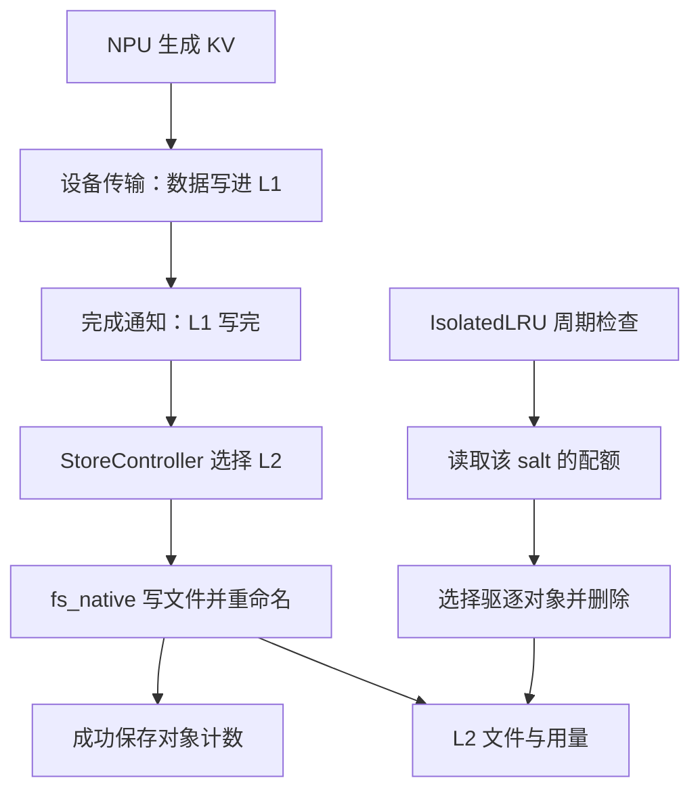

# L2 恒 0：本地源码分析与 LMCache-Ascend 修改方案

日期：2026-10-15。本文是本地分析件；另一侧 NPU Agent 只执行已有 `04_给NPUAgent_精简交接与文本回传.md`，无需承担 GPU 调研或理论分析。

> 后续进展（2026-10-16）：Qwen buffered 正配额实验已收到通过回传，PR305 已合并。当前转入 DS 真实 O_DIRECT 参数取证，见[新证据复核与修复选择](../新问题复核_20261016/01_新证据复核与修复选择.md)。本文保留 10-15 的源码分析及候选设计，不再把正配额实验列作待执行任务。

## 1. 结论与证据边界

**结论：本次应优先补齐配额使用流程；如果希望只改 LMCache-Ascend，已有两条可行路线：部署文档／脚本，以及显式启用的 server-module 配额初始化模块。没有依据为“成功写入后被驱逐”新增 NPU 内存补丁。**

另发现一处 Ascend 原生完成通知的独立候选缺陷：`aclrtLaunchHostFunc` 返回失败时消息被丢弃、调用者没有收到失败。它值得单独制定修复方案，但与本次已成功保存 12 个对象再被驱逐的关联**未核实**。

| 层级 | 当前可以说什么 | 不能越过的边界 |
|---|---|---|
| 用户回传实验 | buffered 写入成功；带 IsolatedLRU 时用量归零；去掉策略后保留文件 | 本地未取得原始运行环境，未亲自重跑 |
| 公开源码 | 本地 MP 未登记配额按 0 处理；零配额强制全量驱逐 | 现场“9-29 v0.1.0”与公开提交逐行一致性未核实 |
| 下一步验收 | 正配额实验可以直接验证正确使用方式 | 对方尚未回传此组结果，不能提前写“已通过” |
| GPU/NPU 差异 | 已确认设备实现、原生绑定和两种控制器语义存在不同路径 | GPU 的实际 salt、配额、版本、控制器运行状态均未核实 |
| 候选修改 | 本文提供具体文件、接口、候选代码、风险与验收 | 未修改仓库代码、未运行候选模块或 NPU 测试，不保证尚未实施的补丁没有缺陷 |

本次联网核对固定如下版本，后文所有行号均以固定提交为准：

| 仓库／对象 | 固定提交 | 说明 |
|---|---|---|
| LMCache dev | `b61b5b4ee4c218f409966c28d864e3066a32758f` | 配额、MP 生命周期、设备抽象、原生 FS |
| LMCache-Ascend main | `b163caf3d968c419acc215182ad2b6560d8bec6f` | 插件覆盖、NPU 原生操作、MP 文档 |
| Ascend PR #305 head | `dc779e5d9e0427fbaef69ff2245d97476811868d` | 2026-10-15 查询为 open、未合并；用户已报告现场验证能解决原 O_DIRECT 故障 |

## 2. 基础概念：要分别回答“能否写”和“能否保留”

**结论：主机内存分配、NPU 搬运和磁盘写入决定数据能否到达 L2；配额和驱逐决定到达后还能保留多久。**

可以把 L1 理解成工作台，L2 是储物柜。NPU 把 KV 搬到工作台，文件后端再放进储物柜；IsolatedLRU 是管理员按分组预算清柜子的规则。搬运工具修好了，并不改变管理员的预算表。

| 概念 | 本问题中的准确含义 |
|---|---|
| allocator／分配器 | 决定主机内存从哪个接口取得、谁负责释放 |
| host register／主机内存注册 | 把已有主机内存登记到设备运行时，用于设备传输；不同于重新分配一份数据 |
| stream／执行流 | 设备任务的执行顺序队列；函数返回可能只是提交成功，数据尚未拷完 |
| completion／完成通知 | 告诉缓存管理器某批传输已完成，可以继续存盘或释放锁 |
| cache_salt | 请求的缓存分组身份；进入缓存 key，影响命中与配额归属 |
| quota／配额 | 某分组的容量预算；本地 MP 路径未登记时为 0 |
| IsolatedLRU | 分组分别维护最近使用顺序；超预算时只选该组对象清理 |
| O_DIRECT | 绕过文件页缓存的 I/O 方式；缓冲区是否适用和地址／长度对齐是不同检查项 |



默认 StorePolicy 会把新写入 L1 的对象送给所有 L2 adapter，并保留 L1；不是等 512 GiB L1 填满才触发。因此“大 L1 尚未满”不能解释这组默认策略下的 L2 恒 0。[M1]

## 3. 两个仓库的真实责任边界

**结论：NPU 专属代码不全在 Ascend 仓；应按实际调用位置决定修改，而不是按类名中有没有 NPU 决定。**

| 责任 | 主仓 LMCache | LMCache-Ascend | 本次如何处理 |
|---|---|---|---|
| MP server、L1/L2 StorageManager | `v1/multiprocess/`、`v1/distributed/` | 使用主仓提供的服务 | 配额决策在主仓 |
| 请求 salt 与 IPC key | 主仓 MP connector、metadata、adapter、ObjectKey | 已检查插件入口没有重写 salt/quota | 没有证据时不新增 salt 补丁 |
| 通用 LazyMemoryAllocator | 主仓普通 CPU 分配、对齐、设备注册 | 旧插件覆盖该分配路径；#305 删除覆盖 | 沿用已验证 #305，不与配额改动混合 |
| NPU pin、IPC、cache context | `v1/platform/devices/npu/` | 提供部分原生操作 | 问题若在主仓 wrapper，就应修原位置 |
| NPU 原生拷贝、kernel、完成通知 | 通过设备抽象加载 | `ops.py`、`csrc/mp_mem_kernels.cpp`、`csrc/completion_recorder.cpp` | 有传输失败证据时，优先审这些真实扩展点 |
| MP 部署指南、Ascend 启用方式 | 提供通用 CLI | `docs/mp_mode/` | 当前最适合在自仓补齐 |

### 3.1 不要改到名字相似的另一套 StorageManager

**结论：Ascend `_patch_storage_manager()` 当前覆盖的是经典进程内后端，改它不会自动修复这次 MP 配额问题。**

它针对 `lmcache.v1.storage_backend.storage_manager` 及 local CPU/disk backend；本次用的是 `lmcache.v1.distributed.storage_manager`。同样，Ascend `_patch_config()` 重建的是 `LMCacheEngineConfig`，不代表独立 MP CLI 会识别新增字段。[A1][A2]

所以本轮不应把 quota 适配塞进这两个旧猴补丁，也不应在 `import lmcache_ascend` 时发 HTTP 请求登记配额。插件会被服务端、worker 和工具导入，导入时不具备明确的目标服务、租户预算或业务准入时机。

### 3.2 已检查范围没有发现 Ascend 丢 salt 的证据

**结论：salt 丢失是可验证候选，当前不是已定位缺陷。**

已核 Ascend 插件入口和相关经典 connector 未出现重写 `cache_salt`、`quota`、`IsolatedLRU` 的实现。公开 MP salt 通路主要在主仓：

```text
request.cache_salt
→ MP request metadata
→ adapter 的 cache_salts
→ IPCCacheServerKey.cache_salt
→ ObjectKey.cache_salt
→ L2 计账与配额检查
```

旧协议缺少字段可能回退成空 salt；现场是否如此**未核实**。只有出现“请求明确设置 tenant_a，但真实 IPC/ObjectKey 为另一值”的证据，才追踪并修对应透传位置。不能把所有 NPU 请求强制归到空 salt，那会改变缓存隔离。[M2][M18]

## 4. IsolatedLRU 的源码推导，以及 GPU 正常的真实软件候选

**结论：本地 MP 的零配额清理逻辑不区分设备。GPU 能用的原因必须从实际路径与运行状态解释。**

本地 MP 调用的是：

```python
limit = quota_manager.get_limit_bytes(cache_salt)  # 未登记 -> 0
if user_bytes < watermark * limit:
    continue
effective_ratio = 1.0 if limit == 0 else eviction_ratio
```

未知 salt 有正用量时，总会达到 `watermark × 0`，比例又被覆盖成 1。因此修改 `.8` 水位或 `.1` 比例本身无效。[M3][M4]

### 4.1 同一个 QuotaManager，有两套查询语义

**结论：公开代码确有“未知分组暂不清理”的另一条路径，但不能直接拿它解释本地 MP。**

| 消费者 | 实际查询方法 | 未登记、且未设置默认值 | 行为 |
|---|---|---|---|
| MP 本地 L2 controller | `get_limit_bytes(salt)` | 0 | 有正用量则全量清理该组 |
| coordinator controller | `effective_limit_bytes(salt)` | None | 跳过该组的配额驱逐 |
| coordinator 显式 default=0 | `effective_limit_bytes(salt)` | 0 | 对未知分组执行零预算清理 |

这使“GPU 与 NPU 走不同控制路径”成为有源码依据的候选。**GPU 现场是否使用 coordinator、是否停用本地 IsolatedLRU、是否已有配额初始化，均未核实。** 仅配置了 coordinator 地址，也不证明本地驱逐器已停用。[M3][M4][M5]

给本地 MP 调 `set_default_limit_bytes(None)` 不能达到放行效果，因为它查询的 `get_limit_bytes()` 根本不读取 default。把 MP 方法直接替换为 coordinator 方法，则是在改变未知租户的处理规则，不是优先的 Ascend 修复。

### 4.2 quota 不是磁盘硬限额

**结论：正确正配额能保留这次数据，但不能据此承诺磁盘永远不会写满。**

- 这是写入后周期清理，不是在写入前拒绝超额对象。
- `.1` 按对象数量选取，取整后非空桶至少一个，不是精确清理 10% 字节。
- IsolatedLRU 与全局容量分支互斥；额外配 `max_capacity_gb` 不会自动再执行一遍全局清理。
- 多 L2 时，HTTP 用量合计各适配器；实际清理逐适配器拿该 salt 的同一 quota 比较。
- 若改为普通 LRU，需要合适的 `max_capacity_gb`，否则缺省容量为 0 时不会启用该全局容量驱逐。

本次只有一个 fs_native adapter，正配额实验可以保持简单；不要顺带改成新的全局容量管理框架。[M4][M6]

### 4.3 重启后 usage 不一定等于整个目录占用

**结论：本版 fs_native 不在构造时扫描整个旧目录恢复计账，不能说“重启必然立即清空旧目录”。**

Python wrapper 的 `_key_sizes` 从空表开始，native 构造主要建目录、取块大小、启动 worker。成功 store 后才通知计账；目标文件已经存在时，native store 可直接返回成功，然后该对象重新进入本进程的使用量统计。[M7][M8]

严谨表述应为：

> 配额表启动时为空。新写入或被本进程重新计账的数据，在未登记配额时可能被清理；尚未纳入本进程统计的旧文件不能通过 API usage 完整反映。

这是使用和观测边界，本轮不顺带实现全盘扫描、旧文件导入或持久化系统。

## 5. NPU 底层：哪些差异确实存在？

**结论：NPU 的内存来源、主机注册、IPC 和完成通知确实可能影响写入，但不会改变 `limit=0 → ratio=1` 的判断。**

### 5.1 #305 改的是内存来源

公开主仓 lazy 路线：

```text
普通 CPU torch.empty(pin_memory=False)
→ 调整基址对齐
→ 当前设备的 pin/register backend
→ NPU 使用 aclrtHostRegister
→ 用于 KV 搬运和文件 I/O 的 L1 缓冲
```

Ascend 旧 lazy 覆盖则先用自有 `alloc_pinned_ptr` 路线取得整池内存，再包装为 Tensor。#305 删除覆盖，恢复主仓路径；它没有改 quota，也没有删除 lazy 功能。`torch.frombuffer` 只包装原内存，不会把它变成普通 CPU 分配。[A3][M9][A7]

因此“用 torch.empty”必须讲清 device 和 pin_memory：`pin_memory=True` 仍可能回到设备主机分配器；不是所有名字叫 Tensor 的缓冲都来自相同分配源。

可由源码直接确认的 GPU/NPU 分叉是：

| 层 | CUDA 路线 | NPU 路线 |
|---|---|---|
| 设备主机注册 | 主仓 `cudaHostRegister` | 主仓 `aclrtHostRegister`，并处理页边界与线程设备上下文 |
| 设备原生操作模块 | `lmcache.cuda_ops` | `lmcache_ascend.ops` |
| 跨进程 Tensor/storage | CUDA IPC 实现 | NPU `_share_npu_` / `_new_shared_npu` wrapper |
| quota 判定 | 由实际启用的通用 controller 决定 | 同样由实际启用的通用 controller 决定 |

前几项可以造成传输能力和内存兼容差异；最后一项仍需比较真实控制路径，而不是仅比较设备名称。[M10][M16][M17][M19]

### 5.2 对齐正确，不等于该内存适合 O_DIRECT

**结论：内存可访问性、地址对齐、长度对齐和生命周期是不同条件，应分别核实。**

Linux 官方文档把 DIO 缓冲列为需要 `FOLL_PIN` 页固定的使用场景；Linux v6.12 的 GUP 检查中，`VM_IO | VM_PFNMAP` 映射会返回 EFAULT。这说明“设备可用的地址”与“内核 DIO 可固定的用户页”不是同一个概念。[K1][K2]

但这**不证明现场 ACL 分配必定具有这些 VMA 标记，也不证明现场内核走了同一分支**。现场内核版本、映射属性和失败调用路径未核实；#305 的改善支持分配路线有关，不能单独证明某个 CANN 页头或唯一内核根因。

若正配额已正确、buffered 正常而 DIO 失败，才继续比较：同样数据、长度、偏移、文件系统下，原 L1 缓冲与普通且满足对齐的 CPU 缓冲。拷贝同时会改变来源、地址、独立性和时序，不能只看“复制后正常”就指定唯一原因。

### 5.3 真正执行的 NPU 函数可能来自 Ascend native

**结论：只读主仓 `NpuDeviceOps` 的 Python fallback 不够；当前固定组合会从 Ascend 加载原生操作。**

```text
主仓 NpuDeviceOps.ensure_native()
→ import lmcache_ascend.ops
→ DeviceOps.bind_native() 逐个绑定 callable
→ 同名实例方法可以覆盖 Python fallback
```

固定 Ascend main 中，下列三项都有 native 实现并经 pybind/ops facade 导出：[M10][A4]

| 操作 | Ascend 实现 | 必须维持的契约 |
|---|---|---|
| `record_completion_on_stream` | `csrc/completion_recorder.cpp` | 通知必须晚于同一 stream 上的搬运完成，不能漏发或提前发 |
| `execute_object_group_transfer` | `csrc/mp_mem_kernels.cpp` | 保持各 step、暂存区和 kernel/copy 的流内顺序 |
| `lmcache_memcpy_async` | `csrc/mp_mem_kernels.cpp` | 返回表示已提交；源/目标须活到真实完成 |

pybind 参数名即使沿用 `cuda_stream_ptr`，也不代表执行 CUDA；Ascend 实现将其解释为 ACL stream。`execute_object_group_transfer` 桥接还明确保留 GIL，以避免 torch_npu task queue 的特定死锁；不能照搬 CUDA 的释放 GIL 做法。[A4]

这才是“尽量只改我们自己”的有效底层切入点；它不适合承载 quota 或改写租户身份。

### 5.4 auto 与两种传输模式的版本限定

**结论：当前公开版本 NPU 的 auto 可解析为 lmcache_driven；复刻改成 auto，不代表一定走 engine_driven。**

主仓 NPU DeviceSpec 声明支持 lmcache_driven，worker 根据声明解析 auto；server 默认也支持 lmcache_driven。旧现场实际模式仍应以日志和加载代码为准。[M11]

两条完成链路可概括为：

```text
LMCache-driven：server 等 producer event → D2H → 按 stream 顺序通知 L1 完成。
Engine-driven：worker gather 并等待完成 → COMMIT → server 完成 L1 写入。
```

Engine-driven 也可以选择异步实现，不能一概称为同步路线。切换模式会改变执行进程、IPC、同步和缓冲位置，其成功不能替代原模式的验收。[M12][M20]

## 6. Ascend 候选缺陷：完成通知投递失败后静默丢失

**结论：这里有具体源码依据，值得单列；它不是当前 quota 归零的既定根因，也不应阻塞本次正配额实验。**

固定 `csrc/completion_recorder.cpp` 的失败分支为：

```cpp
auto err = aclrtLaunchHostFunc(stream, completion_host_callback, raw);
if (err != ACL_SUCCESS) {
  delete raw;
}
```

该函数返回 `void`；payload 包含完成消息的 kind 与字节内容。成功时，ACL 内部线程把 payload 放入完成队列，后续 drain 给上层；失败时 payload 被释放，既没有完成消息，也没有错误传播。[A5]

这意味着：若该调用确实失败，上层可能一直等不到相应完成通知。**现场是否发生这种失败、是否导致挂住，未核实。** 它不解释已经进入成功 L2 保存和后续驱逐的那批对象。

### 修复方案边界

**结论：不能只在这里补一个 throw，然后宣布完成修复。**

投递完成通知之前，copy/kernel 可能已经入队。异常若让上层立即回滚、解锁或复用 L1，就可能在设备仍访问内存时释放所有权。

| 场景 | 应有行为 | 方案状态 |
|---|---|---|
| HostFunc 正常入队 | 维持原有单次通知与 payload 所有权转移 | 现有成功路径保留 |
| 入队失败、调用线程同步同一 stream 成功 | 在确认本次失败未入队的 ACL 契约后，可由调用线程补发一次完成消息 | 候选降级路线；需核 ACL 返回契约并验证，无现场实现 |
| 入队失败、stream 同步也失败 | 必须显式暴露错误；相关缓冲不能按成功路径回收。要先确认上层失败／设备退出时的资源持有规则 | 现有 void 成功通知接口不足以直接证明安全，不能给未验证的“一行补丁” |

同步操作只能在普通调用线程考虑，不能放到 ACL host callback 内；源码明确回调内不调用其他 ACL API。正常成功路径不增加全设备同步。[A5]

建议独立补丁涉及 `csrc/completion_recorder.cpp`，必要时联动 pybind 和调用侧失败处理。先用定向故障注入验证投递失败是否可见、成功完成是否恰好一次、失败后缓冲不提前释放；再做对应 NPU 验证。不要与配额文档、#305 或通用磁盘写入重构混为一个补丁。

## 7. 可实施方案排序：优先留在 LMCache-Ascend

**结论：先做 P0；需要消除 HTTP 初始化与新业务之间的窗口时选 P1。只有出现对应失败证据，再启用 P2/P3。**

| 方案 | 目标与修改位置 | 当前决策 |
|---|---|---|
| P0：部署使用说明 | Ascend `docs/mp_mode/`，先登记配额再接流量 | 现在可以准备；用正配额实验结果完成验收 |
| P1：显式 server-module 装配额 | 新增 Ascend `lmcache_ascend/quota_bootstrap.py`，使用主仓公开扩展接口 | 有明确适用版本的可行自仓方案；下面给候选实现 |
| P2：原生完成通知失败处理 | Ascend `csrc/completion_recorder.cpp` 及必要的桥接／失败生命周期 | 独立候选缺陷，不能当成本次必改 |
| P3：salt 或 IPC 的具体兼容缺陷 | 修真实漏字段或 API 失配处；可能归属主仓，也可能是现场 Ascend fork | 等回传确认，不预设缺陷存在 |
| P4：所有 controller 启动前的初始配额 | 主仓 config 与 StorageManager 构造 | 只有确有这个时序需求才做，不是当前优先路线 |

### P0：最小 Ascend 文档／部署修改

**结论：这是当前风险最低、最直接覆盖已知现象的改动。**

建议新增 `docs/mp_mode/fs_native_l2.md`，在 `docs/mp_mode/README.md` 链接；两份传输模式文档指向这一页，避免重复维护整份说明。当前 MP 文档没有 fs_native + IsolatedLRU + quota 的完整例子。[A6]

内容只需覆盖：实际 salt、零配额含义、8 GiB 测试例、PUT→GET→接业务、重启后重放、实际文件/成功对象/驱逐对象验收，以及 buffered/DIO 与 #305 的版本边界。

部署顺序：

```text
启动自己的 LMCache → 确认实例与 adapter
→ PUT 实际 salt 配额 → GET 确认
→ 启动自己的 vLLM 或放行业务
```

这能覆盖新测试目录和业务入口受控的场景。HTTP ready 前 RPC 已启动，因此若旧客户端仍自动连着 RPC，单靠这个脚本不保证先于那些请求装表。

当前 dev 还可选启用 Bearer 认证；healthcheck 公开，但 quota/status 在开启认证后需要授权头。该提交的 quota CLI 尚不支持传认证头，不能把 401 当成 NPU/配额失败，应使用现有带认证的 HTTP 调用方式。旧现场是否包含该能力未核实。[M13]

### P1：只改 Ascend 的显式配额初始化模块

**结论：当前主仓公开接口允许在 Ascend 包内装配额，并在新实例 RPC 启动前完成；无需 monkey patch。**

主仓真实生命周期是：[M14][M15]

```text
构造 StorageManager
→ 空 QuotaManager
→ 启动 L2 eviction controller
→ 加载 --server-module 工厂
→ 创建并启动 RPC
→ HTTP ready
```

因此工厂抛错会阻止该新实例 RPC 启动，但它晚于 L2 controller 启动，不能宣传成“所有控制器启动前恢复配额”。现场旧版本是否有 `--server-module` 未核实；没有则先用 P0，不为当前实验升级。

拟新增 `lmcache_ascend/quota_bootstrap.py`，以下是**候选代码，仅承载在本文，不是现有代码或已验证补丁**：

```python
# SPDX-License-Identifier: Apache-2.0

from lmcache.v1.multiprocess.ext_server_module import (
    ExtServerModuleBuildContext,
)


def build_server_modules(ctx: ExtServerModuleBuildContext) -> None:
    """Install explicitly configured L2 quotas before RPC starts.

    Args:
        ctx: Server build context carrying a non-empty quotas_bytes mapping.

    Raises:
        ValueError: A salt or byte budget is invalid for this target version.
    """
    quotas = ctx.config.get("quotas_bytes")
    if not isinstance(quotas, dict) or not quotas:
        raise ValueError("quotas_bytes must be a non-empty JSON object")

    entries = list(quotas.items())
    for salt, limit in entries:
        if not isinstance(salt, str):
            raise ValueError("cache_salt must be a string")
        if len(salt) > 128 or any(c in salt for c in ("@", "/", chr(92), chr(0))):
            raise ValueError("invalid cache_salt")
        if type(limit) is not int or limit < 0:
            raise ValueError("quota bytes must be a non-negative integer")

    quota_manager = ctx.server_context.storage_manager.quota_manager
    for salt, limit in entries:
        quota_manager.set_quota(salt, limit)
```

工厂使用的是公开 `quota_manager` 属性，返回 `None` 合法，不需要创建一个空业务模块。该实现用整数 bytes，避免混入浮点换算或隐式布尔预算；先验证全部条目，再写表。salt 约束对应本次固定主仓，回补旧版时要重新确认接口与约束。[M2][M14]

在**原来的 server 命令上追加**以下参数片段；它不是单独运行的命令：

```bash
--server-module '{"module_path":"lmcache_ascend.quota_bootstrap","factory_name":"build_server_modules","config":{"quotas_bytes":{"":8589934592}}}'
```

其中 `8589934592 = 8 GiB`，`""` 是真实空 salt。这里不是 HTTP API，不能把 `_default` 当空字符串写进映射。命名租户按其真实 salt 写入；不建议选择 HTTP 无法区分的字面 `_default`。

该设计的行为边界：

- 仅显式启用时执行；仅安装文件不会改变默认行为，不修改 `__init__.py`。
- 不做 HTTP 自调用、后台重灌、磁盘扫描或未登记租户自动放行。
- 显式 0 仍表示零预算；本次保留实验必须配置正数。
- 启动后 HTTP PUT/DELETE 可以继续调整；静态配置只在每次启动时重新装入。
- 只配置这台实例的本地 MP 配额，不会自动同步 coordinator 或其他实例。

候选变更清单：

| 文件 | 改什么 |
|---|---|
| 新增 `lmcache_ascend/quota_bootstrap.py` | 显式配额工厂 |
| 新增 `tests/v1/multiprocess/test_quota_bootstrap.py` | 针对工厂契约和错误输入的少量定向测试 |
| `docs/mp_mode/fs_native_l2.md` 及入口链接 | 启用方法、目标主仓能力、配额和启动时序限制 |

实施时最少验收：合法空 salt/命名 salt 预算装入；非法输入在写表前失败；模块初始化失败阻止新 RPC 启动；未启用时行为不变；运行时配额仍可更新。NPU 真 fs_native 的正配额保留能力先由另一侧当前实验验证，不用模拟测试冒充硬件证据。

HTTP 对照通过不等同于这个候选模块已经通过。若以后实施并采用 P1，需在目标版本用该模块启动一次，再复用同一长请求确认配额和文件保留；这不是现在追加给对方的实验。

### P4：只有确需控制器前初始化，才改主仓

**结论：当前 Ascend 扩展工厂不够早；需要更早语义时，应在真正拥有生命周期的主仓增加能力。**

最小设计为：

1. 在 `StorageManagerConfig` 增加显式初始配额映射，内部统一整数 bytes；具体新字段/CLI 名称属于待实现设计，当前不存在。
2. 参数解析与直接 Python 构造均校验类型、单位和预算；两个 config 构造返回分支都传递该字段。
3. 在 `QuotaManager()` 后、`L2EvictionController.start()` 前导入所有条目；配置错误阻止启动。
4. 保留未知 salt=0、运行期 PUT/DELETE、coordinator 的另一套 default 语义。

目标通常只涉及主仓 `v1/distributed/config.py`、`storage_manager.py`、相关定向测试与文档。不为此新增持久化框架或自动恢复循环。[M15]

## 8. 回传结果到达后的本地决策

**结论：先按事实缩小方案，不把所有候选改动都提交。**

| 对方回传 | 本地应形成的决定 |
|---|---|
| 正配额后 buffered 文件保留 | quota 使用修复成立；完成 P0，按实际部署需要选择 P1 |
| 正配额正确，但实际 key 属于另一 salt | 沿透传链定位；只有漏字段处确实在 Ascend 才改自仓，否则修拥有者 |
| 低于预算仍被 ratio=1 清理 | 对齐加载源码、实例和真实读取的 QuotaManager；不豁免 NPU 驱逐 |
| 无完成通知或原生 HostFunc 返回失败 | 单列 P2，核对原生绑定和资源生命周期，不把它混入 quota 结论 |
| quota 正确，buffered 正常，DIO 单独失败 | 保持配额不变，沿 #305 实际 allocator、对齐和 errno 排查；无证据不新增 staging |
| GPU 没有可取得的运行信息 | 只提交源码层差异分析；GPU 运行差异原因继续标未核实 |

目前可以准备的交付，是 P0 的文档内容、P1 的候选实现及定向验收清单，以及 P2 的独立缺陷说明。当前不提交 PR、不改实际仓库代码；现场实验仍只执行精简交接中的正配额对照。

## 9. 本轮核对与验证说明

**结论：已完成固定公开源码审查和候选方案整理，未完成硬件或候选实现运行验证。**

- 已联网固定主仓、Ascend main、PR #305 head 与状态，核对具体调用位置。
- 已读取此前现场回传和精简交接要求，没有要求 NPU 侧寻找 GPU。
- 文档中的 Python 候选只做语法检查；不能等同于目标主仓导入、启动时序或硬件验收。
- LMCache-pr 工作区未修改；本文未部署配额、未触碰远端服务。

## 10. 固定源码依据

以下引用中的路径均为对应公开仓库路径，拟新增文件已在正文明确标注。

[A1]: https://github.com/LMCache/LMCache-Ascend/blob/b163caf3d968c419acc215182ad2b6560d8bec6f/lmcache_ascend/__init__.py#L527
[A2]: https://github.com/LMCache/LMCache-Ascend/blob/b163caf3d968c419acc215182ad2b6560d8bec6f/lmcache_ascend/__init__.py#L434
[A3]: https://github.com/LMCache/LMCache-Ascend/blob/dc779e5d9e0427fbaef69ff2245d97476811868d/lmcache_ascend/__init__.py
[A4]: https://github.com/LMCache/LMCache-Ascend/blob/b163caf3d968c419acc215182ad2b6560d8bec6f/csrc/pybind.cpp#L130
[A5]: https://github.com/LMCache/LMCache-Ascend/blob/b163caf3d968c419acc215182ad2b6560d8bec6f/csrc/completion_recorder.cpp#L24
[A6]: https://github.com/LMCache/LMCache-Ascend/blob/b163caf3d968c419acc215182ad2b6560d8bec6f/docs/mp_mode/README.md#L3
[M1]: https://github.com/LMCache/LMCache/blob/b61b5b4ee4c218f409966c28d864e3066a32758f/lmcache/v1/distributed/storage_controllers/store_policy.py#L113
[M2]: https://github.com/LMCache/LMCache/blob/b61b5b4ee4c218f409966c28d864e3066a32758f/lmcache/v1/distributed/api.py#L123
[M3]: https://github.com/LMCache/LMCache/blob/b61b5b4ee4c218f409966c28d864e3066a32758f/lmcache/v1/distributed/quota_manager.py#L86
[M4]: https://github.com/LMCache/LMCache/blob/b61b5b4ee4c218f409966c28d864e3066a32758f/lmcache/v1/distributed/storage_controllers/eviction_controller.py#L309
[M5]: https://github.com/LMCache/LMCache/blob/b61b5b4ee4c218f409966c28d864e3066a32758f/lmcache/v1/mp_coordinator/controllers/eviction_controller.py#L318
[M6]: https://github.com/LMCache/LMCache/blob/b61b5b4ee4c218f409966c28d864e3066a32758f/lmcache/v1/distributed/storage_manager.py#L1012
[M7]: https://github.com/LMCache/LMCache/blob/b61b5b4ee4c218f409966c28d864e3066a32758f/lmcache/v1/distributed/l2_adapters/native_connector_l2_adapter.py#L219
[M8]: https://github.com/LMCache/LMCache/blob/b61b5b4ee4c218f409966c28d864e3066a32758f/csrc/storage_backends/fs/connector.cpp#L78
[M9]: https://github.com/LMCache/LMCache/blob/b61b5b4ee4c218f409966c28d864e3066a32758f/lmcache/v1/memory_allocators/lazy_memory_allocator.py#L145
[M10]: https://github.com/LMCache/LMCache/blob/b61b5b4ee4c218f409966c28d864e3066a32758f/lmcache/v1/platform/devices/npu/device_ops.py#L70
[M11]: https://github.com/LMCache/LMCache/blob/b61b5b4ee4c218f409966c28d864e3066a32758f/lmcache/v1/platform/devices/npu/__init__.py#L82
[M12]: https://github.com/LMCache/LMCache/blob/b61b5b4ee4c218f409966c28d864e3066a32758f/lmcache/v1/multiprocess/modules/lmcache_driven_transfer.py#L764
[M13]: https://github.com/LMCache/LMCache/blob/b61b5b4ee4c218f409966c28d864e3066a32758f/lmcache/v1/multiprocess/http_auth.py#L15
[M14]: https://github.com/LMCache/LMCache/blob/b61b5b4ee4c218f409966c28d864e3066a32758f/lmcache/v1/multiprocess/ext_server_module.py#L91
[M15]: https://github.com/LMCache/LMCache/blob/b61b5b4ee4c218f409966c28d864e3066a32758f/lmcache/v1/distributed/storage_manager.py#L205
[M16]: https://github.com/LMCache/LMCache/blob/b61b5b4ee4c218f409966c28d864e3066a32758f/lmcache/v1/platform/devices/npu/pin_memory.py#L270
[M17]: https://github.com/LMCache/LMCache/blob/b61b5b4ee4c218f409966c28d864e3066a32758f/lmcache/v1/platform/devices/cuda/pin_memory.py#L110
[M18]: https://github.com/LMCache/LMCache/blob/b61b5b4ee4c218f409966c28d864e3066a32758f/lmcache/integration/vllm/lmcache_mp_connector.py#L996
[M19]: https://github.com/LMCache/LMCache/blob/b61b5b4ee4c218f409966c28d864e3066a32758f/lmcache/v1/platform/devices/npu/ipc_wrapper.py#L82
[M20]: https://github.com/LMCache/LMCache/blob/b61b5b4ee4c218f409966c28d864e3066a32758f/lmcache/v1/multiprocess/transfer_context/async_engine_driven.py#L285
[A7]: https://github.com/LMCache/LMCache-Ascend/blob/b163caf3d968c419acc215182ad2b6560d8bec6f/lmcache_ascend/__init__.py#L95
[K1]: https://github.com/torvalds/linux/blob/v6.12/Documentation/core-api/pin_user_pages.rst#L131
[K2]: https://github.com/torvalds/linux/blob/v6.12/mm/gup.c#L1268

- Ascend 真实导出过滤另见 [ops.py](https://github.com/LMCache/LMCache-Ascend/blob/b163caf3d968c419acc215182ad2b6560d8bec6f/lmcache_ascend/ops.py#L32)。
- 原生搬运实现见 [mp_mem_kernels.cpp](https://github.com/LMCache/LMCache-Ascend/blob/b163caf3d968c419acc215182ad2b6560d8bec6f/csrc/mp_mem_kernels.cpp#L506)，以及 [GIL 约束](https://github.com/LMCache/LMCache-Ascend/blob/b163caf3d968c419acc215182ad2b6560d8bec6f/csrc/pybind.cpp#L269)。
- server module 工厂调用见 [loader](https://github.com/LMCache/LMCache/blob/b61b5b4ee4c218f409966c28d864e3066a32758f/lmcache/v1/multiprocess/ext_server_module.py#L326)，RPC 启动见 [server.py](https://github.com/LMCache/LMCache/blob/b61b5b4ee4c218f409966c28d864e3066a32758f/lmcache/v1/multiprocess/server.py#L524)。
